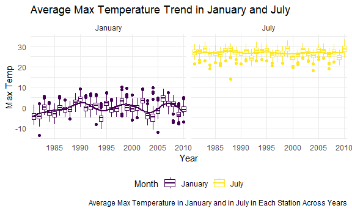
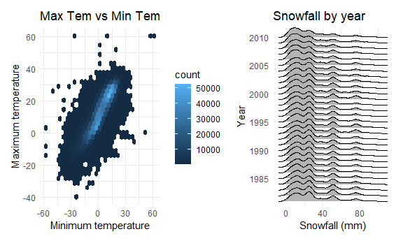

p8105_hw3_xg2489
================

\#`Problem 1`

load the data

``` r
data("ny_noaa")
```

The NOAA New York weather dataset contains daily meteorological records
across multiple weather stations in New York from 1981 to 2010. The
dataset has approximately 2595176 rows (daily observations) and 7
initial columns: `id`, `date`, `prcp`, `snow`, `snwd`, `tmax`, `tmin`.

Missing values are important in this dataset. Many rows contain NA
values for temperature and snow/precipitation measurements, meaning some
daily records lack valid readings. In `tmax`and `tmin`, over 40 percent
of the record is missing which may affect the related plots.

## `1.1`

``` r
ny_noaa_df = ny_noaa |>
  mutate(
    year  = factor(year(date)),   
    month = month(date),  
    day   = mday(date),
    prcp = prcp / 10,       
    tmax = as.numeric(tmax) / 10, 
    tmin = as.numeric(tmin) / 10
  ) 

dim(ny_noaa_df)
```

    ## [1] 2595176      10

``` r
summary(ny_noaa_df)
```

    ##          id               date                 prcp         
    ##  Length   :2595176   Min.   :1981-01-01   Min.   :   0.000  
    ##  N.unique :    747   1st Qu.:1988-11-29   1st Qu.:   0.000  
    ##  N.blank  :      0   Median :1997-01-21   Median :   0.000  
    ##  Min.nchar:     11   Mean   :1997-01-01   Mean   :   2.982  
    ##  Max.nchar:     11   3rd Qu.:2005-09-01   3rd Qu.:   2.300  
    ##                      Max.   :2010-12-31   Max.   :2286.000  
    ##                                           NAs    :145838    
    ##       snow                snwd              tmax              tmin        
    ##  Min.   :  -13.000   Min.   :   0.00   Min.   :-38.90    Min.   :-59.400  
    ##  1st Qu.:    0.000   1st Qu.:   0.00   1st Qu.:  5.00    1st Qu.: -3.900  
    ##  Median :    0.000   Median :   0.00   Median : 15.00    Median :  3.300  
    ##  Mean   :    4.987   Mean   :  37.31   Mean   : 13.98    Mean   :  3.029  
    ##  3rd Qu.:    0.000   3rd Qu.:   0.00   3rd Qu.: 23.30    3rd Qu.: 11.100  
    ##  Max.   :10160.000   Max.   :9195.00   Max.   : 60.00    Max.   : 60.000  
    ##  NAs    :381221      NAs    :591786    NAs    :1134358   NAs    :1134420  
    ##       year             month             day       
    ##  2010   : 159671   Min.   : 1.000   Min.   : 1.00  
    ##  2009   : 148721   1st Qu.: 4.000   1st Qu.: 8.00  
    ##  2008   : 122665   Median : 7.000   Median :16.00  
    ##  2006   :  93249   Mean   : 6.565   Mean   :15.73  
    ##  2007   :  93176   3rd Qu.:10.000   3rd Qu.:23.00  
    ##  2005   :  92177   Max.   :12.000   Max.   :31.00  
    ##  (Other):1885517

``` r
ny_noaa_df |>
  count(snow) |>
  head(10)
```

    ## # A tibble: 10 × 2
    ##     snow       n
    ##    <int>   <int>
    ##  1   -13       1
    ##  2     0 2008508
    ##  3     3    8790
    ##  4     5    9748
    ##  5     8    9962
    ##  6    10    5106
    ##  7    13   23095
    ##  8    15    3672
    ##  9    18    3226
    ## 10    20    4797

We split `date` into `year`, `month`, and `day` for future analysis.
Among the variables, units of `prcp`, `tmax`, `tmin` need to be divided
by 10 because their units are tenth of the reasonable units.

For snow value count, the majority of daily observations have
`snow = 0`, meaning no snowfall on those days. We also observe an
negative value of snowfall (`snow = -13`) which represents an erroneous
data entry and it should be excluded from subsequent analysis.

\##`1.2`

``` r
mean_tmax = ny_noaa_df |>
  filter(month == 1 | month == 7) |>
  mutate(
    month = factor(month, levels = c(1,7), labels = c("January", "July"))
  ) |>
  group_by(id, year, month) |>
  summarise(
    mean_tmax = mean(tmax, na.rm = TRUE)
  ) 
```

    ## `summarise()` has regrouped the output.
    ## ℹ Summaries were computed grouped by id, year, and month.
    ## ℹ Output is grouped by id and year.
    ## ℹ Use `summarise(.groups = "drop_last")` to silence this message.
    ## ℹ Use `summarise(.by = c(id, year, month))` for per-operation grouping
    ##   (`?dplyr::dplyr_by`) instead.

``` r
mean_tmax |> 
  ggplot(aes(x = year, y = mean_tmax, colour = month)) + 
  geom_boxplot() +
  geom_smooth(aes(group = month), se = FALSE) + 
  facet_grid(. ~ month) +
  scale_x_discrete(
    breaks = seq(1980, 2010, by = 5)
  ) +
  geom_smooth(se = FALSE) + 
  labs(
    title = "Average Max Temperature Trend in January and July ", 
    x = "Year", 
    y = "Max Temp",
    caption = "Average Max Temperature in January and in July in Each Station Across Years",
    color = "Month"
  ) 
```

    ## Warning: Removed 5970 rows containing non-finite outside the scale range
    ## (`stat_boxplot()`).

    ## `geom_smooth()` using method = 'gam' and formula = 'y ~ s(x, bs = "cs")'

    ## Warning: Removed 5970 rows containing non-finite outside the scale range
    ## (`stat_smooth()`).

    ## `geom_smooth()` using method = 'loess' and formula = 'y ~ x'

    ## Warning: Removed 5970 rows containing non-finite outside the scale range
    ## (`stat_smooth()`).



This two-panel figure presents boxplots of average maximum temperature
for January and July, grouped by year, with smoothed trend lines
overlaid.

July maximum temperatures are consistently much warmer than January
maximum temperatures. Temperatures fluctuate from year to year. January
shows periodic warmer and colder periods over time, while July
temperatures remain relatively stable and warm across decades.

Outliers are present in both months. January has many warm high-value
outliers. July also a few low-value outliers, including an unusually
cold observation in 1988, representing rare anomalous weather events.

\##`1.3`

``` r
plot_1 = ny_noaa_df |> 
  ggplot(aes(x = tmin, y = tmax)) + 
  geom_hex() +
  theme(legend.position = "right") + 
  labs(
    title = "Max Tem vs Min Tem", 
    x = "Minimum temperature", 
    y = "Maximum temperature"
  ) 
  


plot_2 = ny_noaa_df |>
  filter(snow > 0, snow < 100) |>
  ggplot(aes(x = snow, y = year)) +
  geom_density_ridges() +
  scale_y_discrete(
    breaks = seq(1980, 2010, by = 5)
  ) +
  labs(x ="Snowfall (mm)", y =  "Year", title = "Snowfall by year") 

plot_1 + plot_2
```

    ## Warning: Removed 1136276 rows containing non-finite outside the scale range
    ## (`stat_binhex()`).

    ## Picking joint bandwidth of 3.76



This two-panel figure contains a hexbin (left) and a ridge plot (right).

The left hexbin plot illustrates the positive correlation between
minimum and maximum temperatures, where higher minimums generally align
with higher maximums. The color gradient highlights data density,
showing that most observations are heavily concentrated in the mild
temperature range (min temp between 0°C and 20°C, max temp between 0°C
and 30°C), while rare extreme values outliers still exist.

The right ridgeline plot illustrates the probability density
distribution of annual snowfall. Across the decades, the snowfall data
exhibits a strikingly consistent multimodal distribution, characterized
by distinct primary peaks at approximately 10 mm and 20–30 mm, alongside
smaller secondary peaks near 50 mm and 75 mm. The temporal stability of
these density profiles indicates that the regional snowfall regime is
relatively stable over time.

\#Problem 2

\#Problem 3
